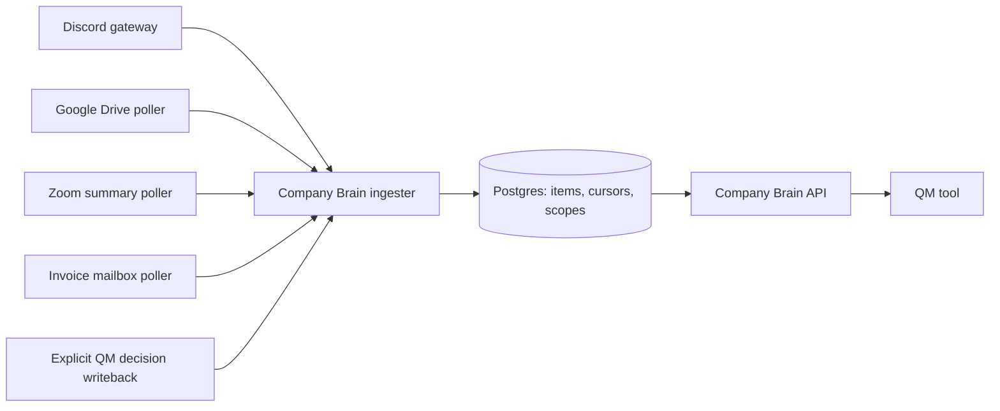

# Startup OS

The UTMIST Startups team's shared memory: a Discord bot that reads the places we already work and tells each director what they missed.

Phase 1 covers ingesting Discord, Zoom meeting summaries, Google Drive and invoice emails, plus `/catchup`.

## Architecture

```
 Discord (live + backfill) ─┐
 Google Drive  (poll 15m) ──┤                         ┌─ /catchup since:1 week
 Zoom summaries (poll 15m) ─┼──► SQLite `items` ──────┤   (only the caller sees it)
 Invoice inbox (poll 15m) ──┘   one row per update,   └─► Claude: group, cite [n], flag owner-less tasks
                                 always with a link
```

- **One Python process.** `discord.py` handles the bot. A `tasks.loop` polls the other sources in worker threads. There's no queue, no worker fleet and no web server.
- **One SQLite table** (`db.py`). Every source becomes the same row shape, `(source, ext_id, ts, author, place, text, url)`. `(source, ext_id)` is the primary key, so re-ingesting the same item never creates a duplicate. The newest `ts` for each source is that source's sync cursor.
- **No vector DB or embeddings yet.** `/catchup` covers a time window, not a search. We load every item in the window and give it to OpenAI in one call. If a window is too big, the oldest items are dropped and the reply says so.
- **Every line has a source.** Items are numbered in the prompt. OpenAI cites them as `[n]`, and `brain.link` turns each citation into a clickable link to the original message, doc or email.
- **It suggests, people decide.** The bot only reads. Its only output is a private (ephemeral) reply.

| File | Role |
|---|---|
| `bot.py` | Discord client, backfill, poll loop, `/catchup` |
| `sources.py` | Drive, Zoom and IMAP ingesters. Each one skips itself when its env vars are unset |
| `brain.py` | Prompt, citation linking, message chunking |
| `db.py` | SQLite storage |
| `test_core.py` | Self-check: `python test_core.py` |

## Setup

```bash
python -m venv .venv
.venv/Scripts/pip install -r requirements.txt   # macOS/Linux: .venv/bin/pip
cp .env.example .env                              # fill it in
.venv/Scripts/python bot.py
```

1. **Discord:** create an app at discord.com/developers. Under Bot, turn on the **Message Content** intent. Invite the bot with the `bot` and `applications.commands` scopes and the Read Messages and Read Message History permissions. Put the token and server ID in `.env`.
2. **OpenAI:** set `OPENAI_API_KEY`. `OPENAI_MODEL` defaults to `gpt-6.2-astra`.
3. **Google Drive:** enable the Drive API, create a Desktop OAuth client, and set `GOOGLE_OAUTH_CLIENT_FILE` to its downloaded JSON. On the first run, sign in through the browser; the local refresh token is saved at `GOOGLE_OAUTH_TOKEN_FILE`. Set `GOOGLE_DRIVE_FOLDER_ID` to the pilot folder's ID so the bot reads only its direct children. A service-account JSON remains a legacy fallback.
4. **Zoom:** create a Server-to-Server OAuth app in the Zoom Marketplace with the meeting summary read scopes. AI Companion meeting summaries must be turned on for the account.
5. **Invoices:** connect to any inbox over IMAP. For Gmail, use `imap.gmail.com` and an app password. `EMAIL_SEARCH` is an IMAP search filter.

On first start, the bot backfills `BACKFILL_DAYS` (default 14) of history from every source.

## Company Brain local MVP

The Company Brain extension is a production-oriented ingestion boundary for the
same Startup OS sources. It does not yet replace the Discord bot or automatically
read QM conversations. It preserves source URLs, makes deliveries idempotent,
and assigns every item to explicit allowed scopes so QM can later retrieve only
the material a user is allowed to see.



Run the local, synthetic proof after Docker Desktop is running:

```powershell
Copy-Item .company-brain.env.example .company-brain.env
docker compose --env-file .company-brain.env -f compose.company-brain.yaml up --build --detach
.\scripts\company-brain-local-smoke.ps1
```

It writes one fake Discord item twice, verifies that the duplicate is ignored,
and confirms the remaining item retains its source URL. Stop it with:

```powershell
docker compose --env-file .company-brain.env -f compose.company-brain.yaml down
```

## Roadmap (from the Startup OS one-pager)

- **Phase 1 (now):** ingest, `/catchup`. Next: the Sunday digest posted to `#digest`, which reuses `brain.catchup` on a weekly `tasks.loop`.
- **Phase 2:** a Monday DM to each director with their 3 things, and Drive edit diffs instead of doc snapshots.
- **Phase 3:** a shared inbox for outreach, plus a project/people graph with suggested tasks and an Accept button.
